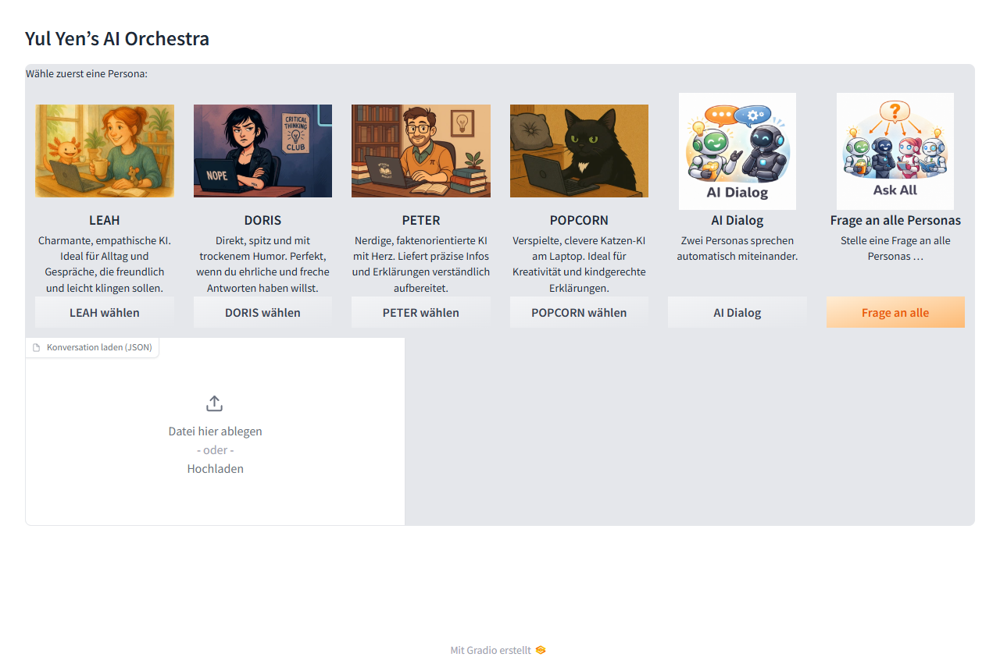
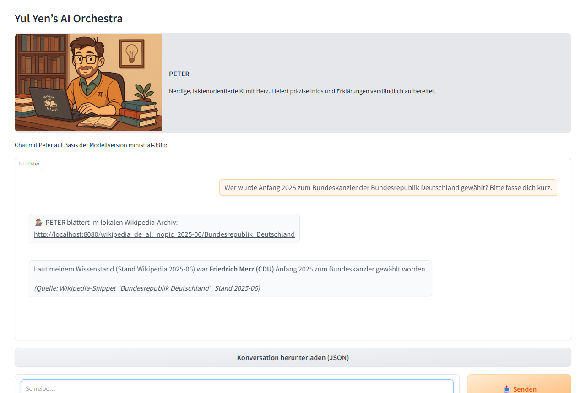
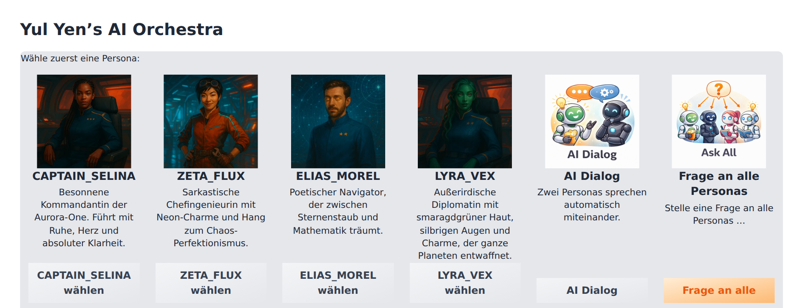

# Yul Yen's AI Orchestra


Ein modulares Multi-Persona-KI-System, das **komplett lokal** läuft — kein Cloud-Zwang, keine Daten verlassen den Rechner.
Vier deutschsprachige Personas (LEAH, DORIS, PETER und POPCORN) mit eigenen Charakteren, **Offline-Wikipedia-Integration** via Kiwix und drei Zugangswegen: Web-UI, Terminal und HTTP-API.



---

## ✨ Highlights

- **4 Personas, 1 lokales LLM** (via [Ollama](https://ollama.com/)) — Charaktere per System-Prompt, Temperatur & Co. pro Persona konfiguriert
- **Offline-Wikipedia**: spaCy extrahiert Schlagwörter, ein lokaler Kiwix-Proxy liefert Artikel-Snippets als Faktenkontext — so kennt das Modell auch Ereignisse **nach seinem Trainings-Cutoff**:

  

- **Ask-All**: eine Frage an alle Personas, Antworten erscheinen live gestreamt
- **AI-Dialog (Self-Talk)**: zwei Personas unterhalten sich automatisch
- **Stop & Nochmal**: laufende Antworten abbrechen (die Teilantwort bleibt stehen) oder mit demselben Kontext neu erzeugen
- **OpenAI-kompatible API**: `/v1/chat/completions` mit der Persona als `model` — damit sprechen Open WebUI, Handy-Apps und Editor-Plugins mit LEAH & Co., inklusive Guard und Wiki
- **Nachrichten als Quelle**: konfigurierte RSS-Feeds werden im Hintergrund geholt; passende Meldungen kommen als Kontext dazu, wenn die Frage danach ist — Small Talk löst nichts aus
- **Gespräche bleiben**: Verlauf in einer lokalen SQLite-Ablage — wiederfinden, fortsetzen, als Markdown exportieren, löschen (in der Web-UI mit Anmeldung)
- **Text-to-Speech** mit Piper (persona-eigene Stimmen; im Terminal automatisch, in der Web-UI per „Vorlesen"-Knopf)
- **Spracheingabe** in der Web-UI: Mikrofon neben dem Eingabefeld, Transkript per faster-whisper (opt-in)
- **E-Mail-Adapter** (opt-in): Personas per IMAP/SMTP anschreiben
- **Security-Guard**: Prompt-Injection-Schutz, PII-Filter, Wrongdoing-Guardrail mit Session-Lock
- **Austauschbare Ensembles**: das Standard-Ensemble `classic` und die Beispiel-Crew `examples/spaceship_crew` liegen bei — Übersicht per `python -m yulyen_ai --list-ensembles`
- **Antwort-Feedback**: 👍/👎 pro Antwort, gesammelt in `data/feedback_votes.jsonl` (neben der Ablage, nicht in `logs/`) als Datenbasis für Auswertung und Finetuning
- **Setup-Doktor**: `python -m yulyen_ai --doctor` prüft Ollama, Modell, spaCy, Kiwix und VRAM mit konkreten Fix-Hinweisen

---

## 🧩 Architekturüberblick

               ┌──────────────────────────────┐
               │   WebUI / Terminal / API     │
               │ (Interaktion, Personas, UI)  │
               └───────────────┬──────────────┘
                               │
                               ▼                 optional:
                  ┌────────────────────────┐   ┌───────────────────────────────────────────┐
                  │     Python Backend     │   │  Lokales Wikipedia-Archiv (Kiwix + Proxy) │
                  │ (Streaming, Security)  │-->│  → Snippets als Faktenkontext ins Modell  │
                  └──────────────┬─────────┘   └───────────────────────────────────────────┘
                                 │
                                 ▼
                       ┌─────────────────┐
                       │      Ollama     │
                       │  (lokaler LLM)  │
                       └─────────┬───────┘
                                 │
                                 ▼
                 ┌─────────────────────────────────┐
                 │ Modelle (z. B. gemma4:26b)      │
                 └─────────────────────────────────┘

---

## 🚀 Schnellstart

```bash
git clone https://github.com/YulYen/YulYens_AI.git
cd YulYens_AI
python -m venv .venv && .venv\Scripts\activate   # Windows (Linux/macOS: source .venv/bin/activate)
pip install -e .                 # editierbar: das Paket zeigt auf diesen Checkout
python -m spacy download de_core_news_lg
ollama pull gemma4:26b           # kleinere Karte: ministral-3:14b oder :8b, siehe unten

python -m yulyen_ai --doctor        # Preflight-Check: läuft alles?
python -m yulyen_ai -e classic     # Start (Web-UI auf http://127.0.0.1:7860)
```

---

## 🎭 Mitgelieferte Ensembles

Ein *Ensemble* ist ein Satz Personas mit eigenen Prompts, LLM-Optionen und Avataren.
Welches gestartet wird, entscheidet `-e`. Drei Ensembles liegen im Repo:

| Name für `-e` | Personas | Charakter |
|---|---|---|
| `classic` | LEAH, DORIS, PETER, POPCORN | Standard-Besetzung: warmherzig, bodenständig, sachlich, verspielt |
| `examples/classic_ministral14b` | LEAH, DORIS, PETER, POPCORN | dieselbe Besetzung, abgestimmt auf `ministral-3:14b` — für Karten mit 12–16 GB, zusammen mit `core.model_name: "ministral-3:14b"` |
| `examples/spaceship_crew` | CAPTAIN_SELINA, ZETA_FLUX, ELIAS_MOREL, LYRA_VEX | Crew des Raumschiffs *Aurora-One* — Kommandantin, Chefingenieurin, Navigator, Diplomatin |

```bash
python -m yulyen_ai --list-ensembles              # welche gibt es?
python -m yulyen_ai -e examples/spaceship_crew    # Beispiel-Crew starten
```



Eigene Ensembles brauchen keinen Code, nur YAML und Bilder —
siehe [Eigenes Ensemble anlegen](docs/de/Ensemble_hinzufuegen.md).

---

## 📖 Dokumentation

- 👉 [Deutsche Hauptdokumentation](docs/de/ReadMe.md)
- 👉 [Englische Dokumentation](docs/en/ReadMe.md)
- 👉 [Funktionsübersicht (DE)](docs/de/Features.md) / [Features (EN)](docs/en/Features.md)
- 👉 Anleitung zum
   [Eigenen Ensemble (DE)](docs/de/Ensemble_hinzufuegen.md) /
   [Custom ensemble (EN)](docs/en/Adding_an_ensemble.md)
- 👉 [Changelog](CHANGELOG.md) — was sich für Betreiber ändert (englisch)
- 👉 [Feature-Backlog](backlog.md)

---

## 💡 Projektstruktur (Kurzüberblick)

- `src/` – Anwendungscode (Web-UI, Terminal-UI, API, Core-Logik, E-Mail-Adapter, TTS, Security)
- `ensembles/` – Konfiguration der Personas (Prompts, LLM-Optionen, Avatare)
- `scripts/` – Hilfsskripte (Modell vorwärmen, MCP-Server, Mail-Probe, Abhängigkeits-Audit)
- `locales/` – UI-Texte (DE/EN)
- `docs/` – Dokumentation & Screenshots
- `logs/`, `tests/` – Laufzeitdaten & Pytest-Suite

---

## ⚙️ Mindest-Anforderungen

- **Python 3.12+** (die CI prüft 3.12 und 3.14)
- **Ollama** (lokal installiert)
- mindestens ein lokales Modell, passend zur Grafikkarte — pullen und, wenn es
  nicht der Default ist, in `config.local.yaml` unter `core.model_name` eintragen:

  | VRAM | Modell | Ensemble | Anmerkung |
  |---|---|---|---|
  | 16 GB (+ RAM) | **`gemma4:26b`** (Default, 18 GB) | `classic` | liegt teils im RAM: erster Start ~25 s, danach am schnellsten |
  | 12–16 GB | `ministral-3:14b` (~9 GB) | `examples/classic_ministral14b` | liegt ganz auf der GPU |
  | 8 GB | `ministral-3:8b` | `classic` | in `ensembles/classic/personas_base.yaml` `num_ctx: 8192`, in `config.local.yaml` `wiki.snippet_limit: 1200` |

  Gemessen und verkostet wurde das auf genau diesen drei Karten; die Berichte
  dazu liegen im Stand [`v3.0.0`](https://github.com/YulYen/YulYens_AI/tree/v3.0.0/docs).

---

## 🧠 Lizenz & Beiträge

Dieses Projekt steht unter der [MIT-Lizenz](LICENSE).
Beitragsrichtlinien und Verhaltenskodex findest du unter
[`CONTRIBUTING.md`](CONTRIBUTING.md) und [`CODE_OF_CONDUCT.md`](CODE_OF_CONDUCT.md).

---

### For English speakers
This repository hosts **Yul Yen's AI Orchestra**, a modular local multi-persona AI system.
See the [English documentation](docs/en/ReadMe.md) for details.
